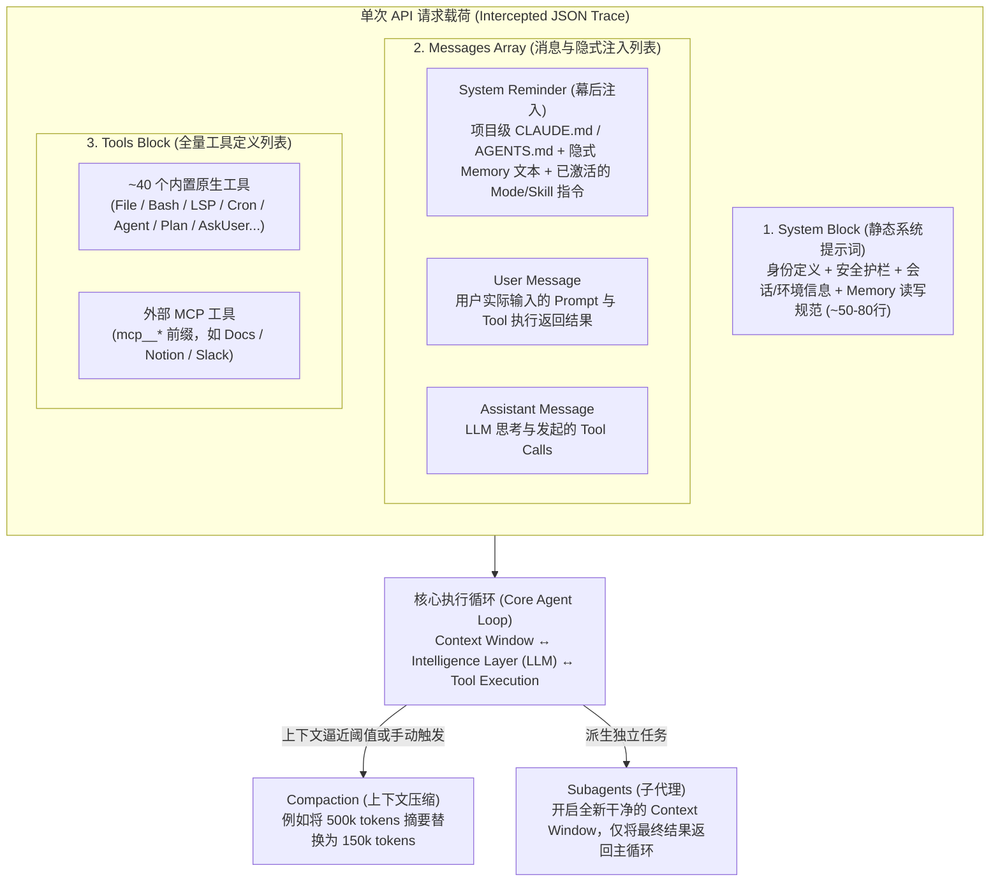

本文整理自斯坦福大学课程 **The Modern Software Developer** 中由 **Mihail Eric** 主讲的课堂实录。在这堂课中，讲师使用类似 Wireshark 的代理抓包工具拦截了 [[claude-code]] 在开发一个命令行 To-do 应用时的完整 HTTP 请求与响应（JSON Trace），从协议与上下文拼装的视角，完整拆解了一个最前沿 Coding Agent 的 **Harness（智能体编排框架）**。

> [!note] 核心主旨
> Coding Agent 的核心执行循环（User ↔ LLM ↔ Tools）只需 200 行代码即可写出原型，但决定工业级 Agent 上限的是包裹在模型外围的 **Harness**。当前行业演进的核心矛盾是**能力丰富度与上下文膨胀（Context Bloat）之间的博弈**：尽量用“少而精的瑞士军刀工具（如 Bash/SQL）+ 渐进式披露的 Skills + 干净上下文的 Subagents + 极简 System Prompt”，把复杂推理交还给不断进化的底层模型，避免上下文跌入“变蠢区（Dumb Zone）”。

---

## Harness 全景架构与请求拼装链路

当你向 [[claude-code]] 发送第一句简单的提问时，发往服务端 API 的单个 JSON 请求体中其实已经由 Harness 在幕后拼装了成千上万 Token 的结构化信息：



---

## 六大核心组件深度拆解

### 1. Tool Lists（工具列表）：从“百种专用工具”回归“瑞士军刀”

工具是静态权重模型接触真实世界（本地文件系统、Shell、网络）的唯一桥梁。工具的名称、函数签名、参数类型与注释（Docstring）都会**原封不动地注入每一次请求的上下文窗口**。

#### Claude Code 的约 40 个内置工具分类

Anthropic 团队通过后训练（Post-training）让模型针对这 ~40 个原生工具做了深度优化：

- **文件与系统交互**：读写/编辑文件、通过 `Bash` 交互执行 Shell 命令。
- **代码语义检索**：基于 **LSP（Language Server Protocol）** 的代码检查与搜索工具，以及 Web 搜索工具。
- **任务编排与调度**：启动子代理的 `Agent` 工具、进入/退出规划模式的工具、类似 `cron` 的定时监控与调度工具。
- **人机协同与扩展**：向用户提问（`AskUserQuestion`）、调用技能（Skill）、创建 Artifacts、读取 MCP 资源、推送通知与反馈。

#### MCP 工具 vs. Skills vs. 瑞士军刀工具

| 维度           | MCP Tools (`mcp__*`)                                                                            | Built-in Swiss Army Knife (如 `Bash` / `SQL`)                   | Skills (`SKILL.md` 等)                                                             |
| :------------- | :---------------------------------------------------------------------------------------------- | :-------------------------------------------------------------- | :--------------------------------------------------------------------------------- |
| **抽象层级**   | **最小原语（Primitive）**：类似单次 API 调用（输入 → 输出）                                     | **图灵完备/通用表达层**：本身是一门完整语言，可组合任意复杂操作 | **流程编排（Codified Procedure）**：将多步工具调用、脚本和提示词缝合成标准作业程序 |
| **上下文开销** | **高（全量常驻）**：每挂载一个 MCP Server，其所有工具 Schema 在**每次请求**中都会全量塞入上下文 | **极低**：仅需极少量的工具定义即可覆盖海量长尾操作              | **按需加载（渐进式披露）**：初始仅在上下文中放极简 Metadata，匹配任务时才拉取全文  |
| **演进趋势**   | 2024 年底早期 GitHub MCP 动辄暴露 110+ 个工具，严重撑爆上下文；如今趋向严控挂载数量             | **行业主流方向**：用 3~5 个极强的基础工具替代几十个细碎工具     | 成为沉淀领域工作流、替代臃肿工具集的首选方案                                       |

---

### 2. System Prompt 与 Memory：系统提示词瘦身与纯文本记忆

#### 静态 System Prompt 的持续瘦身

- 在截获的 Trace 顶部，`system` 块包含两部分：一句简短的身份声明（`You are Claude Code, Anthropic's official CLI for Claude.`）和一段约 **50~80 行**的核心行为蓝图（涵盖软件工程职责、安全边界、会话与上下文管理）。
- **为什么比早期短得多？** 几个月前该提示词还有 200~250 行（包含大量如何用 Git、如何拆解任务的显式指令），近期削减了约 8% 甚至更多。因为随着模型迭代，**常规工程能力已被内化（Baked in）到模型参数权重中**，不再需要占用宝贵的用户上下文窗口去教模型怎么用 Git。

#### 隐式记忆（Implicit Memory）：为什么用 Flat Files 而不是 RAG？

- **工作机制**：System Prompt 中包含一大段关于 Memory 的读写规范，指向本地项目级的文件系统路径。模型在交互中自主判断何时按指定元数据格式将用户偏好或项目经验写入该目录，并在后续请求中作为独立文本块拼接到提示词中。
- **工程洞察（Flat Files vs. RAG/GraphRAG）**：课堂问答中提到，为什么不用向量数据库（RAG）或知识图谱（GraphRAG）做记忆检索？基准测试（Benchmarks）和业界实践（包括讲师所在公司的销售 Agent 实践）表明，对于项目级记忆，**直接让强模型解析扁平纯文本文件（Flat text files），往往比引入复杂脆弱的 RAG 架构效果更好、维护成本更低**。

---

### 3. `CLAUDE.md` 与 `AGENTS.md`：警惕“指令过拟合”

- **定位**：如果说 System Prompt 是 Harness 控制的静态护栏，那么 [[claude-md]] / [[agents-md]] 就是**用户可控的系统提示词对等物**。在抓包 Trace 中，它被 Harness 包装在 `<system-reminder>` 中塞入第一条 User 消息顶部，并声明：`these instructions override default behavior and must be followed exactly as written`。
- **生态收敛**：业界基本已围绕 `AGENTS.md` 达成通用标准，Claude Code 目前也已支持将 `CLAUDE.md` 软链接（symlink）到 `AGENTS.md`。
- **编写反模式（Overconstraining）**：许多开发者误以为往 `CLAUDE.md` 里塞入越多的代码片段和死板规则越好。实际上，**写得过多会过度约束（Overconstrain）模型，导致模型“过拟合”于你的局部指令**，丧失自主推理弹性。最佳实践是保持极简：只放项目高频核心路径说明，以及 1~2 条运行单测或启动服务的精确命令。参见 [[claude-agent-prompting-best-practices]]。

---

### 4. Plan Mode（计划模式）：Prompt 驱动的受限状态机

课堂中演示的为 To-do 应用增加“周期性定时任务（Recurring scheduled tasks）”的案例，正是我们此前在 [[claude-code-plan-mode]] 中逐行解析的那份系统提示词的真实现场：

- **本质**：Plan Mode 并不是一个神秘的底层二进制模块，而是当调用“进入计划模式”工具后，**由 Harness 向对话流注入的一段工作流文本指令**。
- **五阶段闭环**：Phase 1（启动 `Explore` 子代理理解代码）→ Phase 2（启动 `Plan` 子代理多视角设计）→ Phase 3（主代理复核并向用户提问对齐）→ Phase 4（将唯一推荐方案写入白名单 `.md` 计划文件）→ Phase 5（调用退出工具请求批准）。

---

### 5. Skills（技能）：渐进式披露（Progressive Disclosure）

为什么有了 MCP 还要引入 [[agent-skills]]？

- **解决上下文爆炸**：MCP 工具每次请求全量加载；而 Skills 采用**渐进式披露**——平时只暴露几句话的 `name` 和 `description` 元数据。
- **双触发机制**：既可由用户显式点名调用（如 `"Check my code quality. Use the skill."`），也可由模型根据上下文主动触发。触发瞬间，Harness 才会在后台定位对应的 `SKILL.md` 文件，将其完整步骤说明作为命令消息块动态注入当前上下文。

---

### 6. Subagents（子代理）与 Compaction（上下文压缩）

这两项机制的核心目的只有一个：**对抗上下文腐化，防止模型滑入“变蠢区（Dumb Zone）”**。

- **Subagents（上下文隔离与并行）**：
  - 主控制循环（Orchestrator）通过工具调用派生出 Worker 子代理。
  - **最大的收益不仅是并行，更是“干净的上下文”**：子代理不继承主代理此前冗长的历史包袱，而是在一个全新的 Context Window 中翻箱倒柜做代码探索或性能检查，最后**只把提炼后的结论返回给主代理**，保护主代理上下文不被中间搜索垃圾污染。
- **Compaction（压缩模式）**：
  - 当会话逼近上下文窗口上限（自动触发）或用户执行 `/compact`（手动触发）时，Harness 会注入一段专门的摘要 Prompt，将此前例如 500,000 tokens 的对话历史浓缩为 150,000 tokens 的高密度摘要，并直接替换掉原始上下文，供后续轮次继续推进。

---

## 课堂核心原话与工程批注

### 1. 为什么 MCP 工具过多会害死 Agent？

```text
Here, we're dropping in all the tools. Every MCP server you've loaded, including third-party servers, appears in this block. Every time you send a request, it gets that set of tools.
...
You have to be careful about which MCP tools and servers you introduce because they can blow up your context. The more irrelevant material you include, the more likely the coding agent is to perform poorly on tasks.
```

> [!tip] 译文与解析
> 在这里，我们把所有工具都塞了进去。你加载的每一个 MCP 服务器（包括第三方服务器）都会出现在这个区块里。你每发一次请求，它都会带上这一整套工具。……你必须非常小心引入了哪些 MCP 工具和服务器，因为它们会撑爆你的上下文。你塞入的不相关材料越多，编码智能体在任务上的表现就越可能变差。
>
> **工程启示**：在配置 `.claude/settings.json` 或 IDE 的 MCP 列表时，切忌“集邮式”开启十几个用不上的 MCP Server。还没写第一行字，几万 Token 的工具 Schema 就已经把模型推向“变蠢区”了。

### 2. Model 还是 Harness？行业钟摆的演进

```text
One reason Claude Code became so popular around December of last year was its minimalist harness. For a long time, it had a restrictive set of tools that could still do almost everything... The general industry trend is toward reducing complexity. The more you can do with fewer tools, the better. People think about finding those powerful Swiss Army knife tools. SQL and Bash are two examples.
...
That's a big question in agent design: do you invest in the model or the harness? We regularly seesaw between the two... Right now, we're at a point where people want the harness to be as simple and concise as possible.
```

> [!tip] 译文与解析
> Claude Code 去年 12 月左右爆火的原因之一，就是它极简的 Harness。在很长一段时间里，它只有一套很克制的工具集，却依然能完成几乎所有事情……行业的总体趋势是降低复杂度。用越少的工具办越多的事，效果就越好。大家都在寻找那些强大的“瑞士军刀”工具，`SQL` 和 `Bash` 就是两个典型例子。
> ……这是智能体设计中的一个核心问题：你应该投资于模型（Model），还是投资于编排框架（Harness）？我们经常在两端像跷跷板一样摇摆……而现在，我们正处于“大家希望 Harness 尽可能简单、精炼”的阶段。
>
> **工程启示**：不要在 Harness 层写过于死板、沉重的硬编码编排逻辑去替模型做决定；随着基础模型推理能力的跃升，过去为了“防模型犯傻”而堆砌的 250 行长系统提示词和上百个专用小工具，反而成了限制新模型发挥的枷锁。
