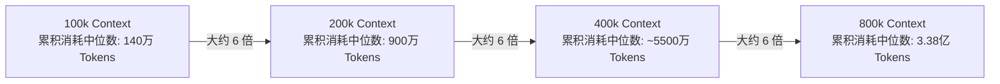
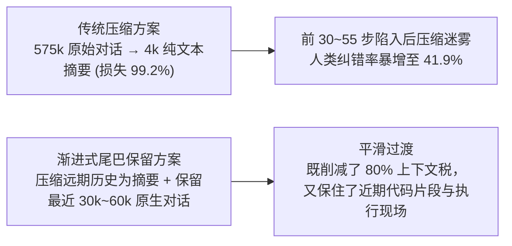

很多使用 [[claude-code]] 或各类 Coding Agent 的开发者都形成了一个直觉误区：“既然现在的模型支持 100 万甚至更大上下文，而且 Prompt Caching（提示词缓存）价格极其低廉，那我就让 Agent 一直跑，不用急着执行 `/compact` 或清理对话。”

LangWatch 团队基于 **2,451 个真实 Agent 会话、287,748 次跟踪 API 调用、201 次人工审计步骤与 873 次真实压缩记录** 的全量遥测数据，给出了明确结论：**必须压缩，而且压缩的时机通常应落在 250k 到 450k tokens 之间，没有任何合理的理由放任 Agent 的上下文滑向 100 万大关。**

知识库关联：关于 Agent 外围框架设计请参考 [[anatomy-of-coding-agent-harness]]，状态机管理参考 [[claude-code-plan-mode]]，严谨工作流规范参考 [[pstack-agent-engineering-workflow]]。

---

## 核心主旨：上下文税（Context Tax）的隐形陷阱

> [!note] 为什么 Prompt Cache 掩盖了巨大的成本？
> 当一个 Agent 在 500k 上下文的大窗口下执行一轮包含 25 次工具调用（读文件、跑单测、格式化、查 Git）的任务时，**它不是向 LLM 发起了一次 500k 的缓存读取，而是发起了 25 次不断累加的 500k 级完整调用（即 25 × 500k+）**。即使缓存命中使得每百万 Token 的单价便宜了一个数量级，海量的工具步数乘积依然会导致 Token 消耗与计费限额瞬间爆炸。与此相对，窗口扩大 16 倍后，Agent 真正能有效利用的上下文增量却微乎其微。

---

## 上下文税的“幂律增长”机制

在持续交互中，上下文大小与其累积耗费的 Token 呈现极其陡峭的**幂律分布（Power Law）**：**上下文大小每翻一番，获取该上下文所累积消耗的 Token 开销增长约 6 倍。**

### 头号 Token 杀手：长寿命分叉子代理（Forked Subagents）

实测案例中，团队曾在一天内耗尽 22.5 亿 Tokens，其中 **82% 的消耗不是来自人类敲击的键盘，而是由后台派生的子代理产生的**；更惊人的是，其中 11.4 亿 Tokens 仅仅来自于 **2 个失控的长命子代理**：

1. **带初始包袱启动**：这两个子代理是通过 Fork 方式创建的，直接完整继承了父协调器（Coordinator）已有的 523k 和 304k 上下文（而全新冷启动的子代理通常只有约 30k）。
2. **长寿命累加**：子代理运行了 8~10 个小时，执行了数百上千次 API 请求。
3. **高频命令行执行**：子代理每次执行 `pnpm test` 或 `git status`，都需要将全量上下文重新发给模型。在接近 100 万 Token 的上下文峰值下，**一次简单的单测调用在真正开始执行测试代码之前，就已经被内核扣掉了 56.8 万 Tokens 的上下文税**。

---

## 压缩的双刃剑：后压缩迷雾（Post-Compaction Fog）

如果无节制膨胀成本极高，那为什么大家不每隔 50k 就压缩一次？研究团队量化了压缩对 Agent 智能行为的负面冲击。

### 1. 行为劣化指标：人类纠错率暴增 2.37 倍

在对 873 次压缩事件的追踪中，中位数压缩将 **574,875 tokens** 的原始材料压缩到了仅剩 **4,382 tokens** 的精炼摘要——**仅保留了不到 0.8% 的原始内容**，单次压缩耗时中位数为 142 秒。

通过分析人类用户发出的“纠正类提示词”（Correction Prompts，如指出参数错误、指出误判既有逻辑等）：

- **平稳基线期**：人类干预/纠错率约为 **17.7%**。
- **压缩后前 5 步（后压缩迷雾）**：人类纠错率瞬间飙升至 **41.9%（2.37 倍）**！
- **失真延续期**：这种失真状态在随后的 **30 步内保持高位**，直到 120 步后才彻底恢复到基线水平。
- **工具报错并未增加**：在失真期，工具执行失败率依然平稳在 2.6%~3.2%（说明语法和调用仍然通顺），但**这些工具调用背后的工程决策质量显著下降了**。

### 2. 压缩频率的陷阱（Floor Limit）

如果压缩阈值设置得过低（例如 146k）：

- 每次压缩完剩下约 66k，Agent 平均每步产生约 1,470 tokens，只需 55 步就会再次触发压缩。
- 如果一次压缩引发的劣化恢复期刚好需要约 55 步，那么 **Agent 的整个生命周期将 100% 陷入“刚被截肢、正在摸索重建记忆”的低效迷雾中**，永远无法在清醒状态下做实质推进。

---

## 分场景最佳压缩阈值推荐矩阵

综合平衡“上下文税带来的算力成本”与“后压缩迷雾造成的人工修正/返工代价”，研究模型给出了各研发场景的推荐压缩窗口：

| 任务类型                               | 推荐压缩阈值    | 核心考量与依据                                                                                                    |
| :------------------------------------- | :-------------- | :---------------------------------------------------------------------------------------------------------------- |
| **PR 审查与推进 (Driving a PR)**       | **200k ~ 250k** | 原生文本强依赖度极低（仅约 2%），摘要足以支撑判断，宜尽早压缩以控制审查成本。                                     |
| **技术调研与方案探索 (Research)**      | **250k ~ 300k** | 调研过程相对自包含，阶段性结论一旦提炼，早期的原始搜索垃圾可安全丢弃。                                            |
| **QA 测试与实机试用 (Dogfooding)**     | **250k ~ 350k** | 测试日志衰减极快，虽然有少量细节依赖，但保留摘要与关键断言即能满足需求。                                          |
| **核心业务构建 (Building / Features)** | **300k ~ 450k** | **原生文本依赖度最高**。代码精确字符串编辑（`str_replace`）对变量名、调用签名的记忆极其敏感，需要更大的清醒窗口。 |
| **遗留系统理解 (Code Understanding)**  | **300k ~ 450k** | 代码调用拓扑与历史决策依赖缓慢累积，过早压缩会导致 Agent 反复重新翻阅同一批文件。                                 |

> [!important] 明确边界
>
> - **硬下限（< 200k）**：除非是极度细碎的单步任务，否则频繁压缩会引发“迷雾重叠”，纯属自我消耗。
> - **硬上限（> 600k）**：不仅 Token 消耗呈爆炸级飙升，多份基准测试表明 600k 以上模型注意力分散，几乎找不到任何足以弥补成本的智商收益。

---

## 工程优化方案：保留“原生上下文尾巴”（Verbatim Tail）

单纯依靠调整压缩阈值（Threshold）只是治标，根本问题在于当前主流工具在触发压缩时**过于极端地切除了 99% 的上下文**。

更优的 Harness 架构实践是：**摘要历史 + 保留近期原生尾巴（Verbatim Tail）**。

### 落地建议清单

1. **严格监控子代理生命周期**：避免派生继承大上下文的长寿命 Worker。子代理任务必须高度原子化，跑完立即返回并销毁。
2. **重度操作前手动清理**：在启动大规模测试套件、全量 Lint 或大型重构之前，主动执行一次 `/compact` 或清理现场，不要带着 500k 上下文去跑几百条命令。
3. **日常任务锚定 300k~400k**：在构建业务代码时，将 350k 作为心理预警线，400k 左右完成当前里程碑并执行压缩，获得最平稳的性价比体验。
