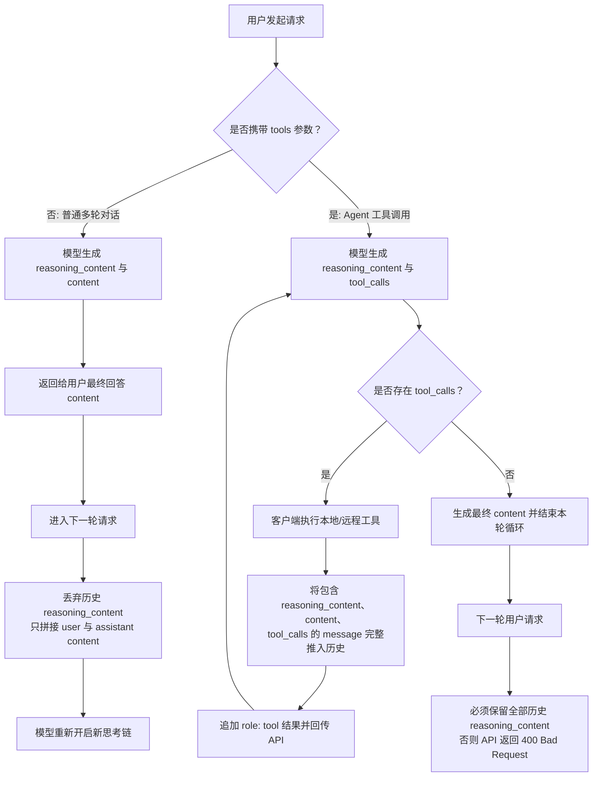

在 [[reasoning-model]]（推理模型）中，模型在给出最终回答前会先输出一段隐式或显式的思维链（Chain of Thought, CoT），以此显著提升在复杂推理、数学证明、代码编写以及逻辑决策上的准确性。在 DeepSeek 的接口架构中，这一能力被标准化为**思考模式（Thinking Mode）**。

与纯自然语言对话相比，思考模式在 API 层面引入了独立的推理字段（`reasoning_content`）、独特的跨厂商 SDK 适配规则，以及极易导致请求报错的上下文回传状态机。本文基于 DeepSeek 官方指南，系统梳理思考模式的接入规范与工程避坑法则，亦可与 [[claude-agent-adaptive-thinking]] 及 [[claude-agent-effort]] 对照阅读。

> [!note] 核心主旨
> DeepSeek 思考模式将推理过程显式分离为 `reasoning_content`。在没有工具调用的普通多轮对话中，推理内容无需且不应拼接进后续历史；但在包含工具调用（Tools）的 Agent 循环中，**所有历史轮次的 `reasoning_content` 必须严格完整回传**，否则会导致 API 直接拒绝并返回 HTTP 400 错误。

---

## 全景状态机与工作流

思考模式在运行时根据请求中是否携带 `tools` 参数，呈现完全不同的上下文流转路径：



---

## 核心机制拆解

### 1. 思考模式开关与强度控制映射

DeepSeek 思考模式默认处于开启状态，且默认思考强度为 `high`。为了兼容不同客户端生态，DeepSeek API 同时支持 OpenAI、Anthropic 以及 Responses API 三套参数控制范式：

| 控制项           | OpenAI 格式                                             | Anthropic 格式                                  | Responses API 格式                                                  |
| ---------------- | ------------------------------------------------------- | ----------------------------------------------- | ------------------------------------------------------------------- |
| **思考模式开关** | `extra_body={"thinking": {"type": "enabled/disabled"}}` | `{"thinking": {"type": "enabled/disabled"}}`    | `{"reasoning": {"effort": "none/low/high/max"}}`（`none` 表示关闭） |
| **思考强度控制** | `reasoning_effort="low/high/max"`                       | `{"output_config": {"effort": "low/high/max"}}` | `{"reasoning": {"effort": "low/high/max"}}`                         |

> [!important] OpenAI SDK 的 extra_body 传参约束
> 使用官方 OpenAI Python SDK 时，由于 `thinking` 字段不是 OpenAI Chat Completion 原生标准字段，必须将其通过 `extra_body={"thinking": {"type": "enabled"}}` 传递，而 `reasoning_effort` 则可直接作为顶层参数传入。

用户请求中传入的 `effort` 参数会根据下表映射到底层推理引擎的实际计算强度：

| 请求传入 effort | 实际映射 effort | 说明                   |
| --------------- | --------------- | ---------------------- |
| `minimal`       | `low`           | 适用于极速轻量推理     |
| `low`           | `low`           | 低强度思考             |
| `medium`        | `high`          | 向上对齐到 high        |
| `high`          | `high`          | 默认标准高强度推理     |
| `xhigh`         | `high`          | 超高请求暂按 high 处理 |
| `max`           | `max`           | 极高强度推理           |
| `ultra`         | `max`           | 极限算力分配           |

---

### 2. 输入输出参数兼容性

为了确保对既有开发框架与中间件的兼容，部分生成控制参数在思考模式下被明确禁用或差异化处理：

1. **完全失效的参数**：
   - `temperature`
   - `presence_penalty`
   - `frequency_penalty`
   - 传入上述参数不会触发校验异常，但 API 底层会自动忽略，不会产生任何实际影响。
2. **`top_p` 参数的模型分歧**：
   - `deepseek-flash`：仅在思考模式下生效，有效取值范围被截断在 `[0.95, 1.0]`，低于 0.95 的值会被强制钳位到 0.95；在非思考模式下恒固定为 1.0。
   - `deepseek-v4-pro`：在思考模式下会完全忽略传入的 `top_p`（若启用了工具调用则内部固定为 0.95，未启用工具调用则固定为 1.0）；在非思考模式下传入值才会生效。注意：即使请求传入了 `tools`，只要将 `tool_choice` 显式设为 `none`，也会被视作关闭工具调用。
3. **输出字段结构**：
   - 思考链内容由独立的 `reasoning_content` 字段承载，与常规文本输出 `content` 同级并列。

---

### 3. 多轮对话上下文拼接规则

思维链是模型内部的推导轨迹，在多轮对话中盲目将所有推导历史原样塞回 Prompt，会导致上下文窗口被快速消耗，甚至引发思维固化。DeepSeek 确立了严格的分流原则：

![[deepseek-thinking-multiround-chat.jpeg]]

_图 1：普通多轮对话（无 tools）下的上下文拼接机制_

- **无 `tools` 参数的常规对话**：
  - 在生成回答时，模型返回 `reasoning_content` 与 `content`。
  - 在后续轮次中，**无需回传上一轮的 `reasoning_content`**。即使客户端传入了该字段，API 服务端也会直接忽略，绝不会将其拼接进上下文。
  - 客户端只需将 `{"role": "assistant", "content": content}` 存入历史即可。

---

### 4. 带有工具调用（Tool Calls）的思考模式与 400 避坑

当引入 Agent 架构中的函数调用（Function Calling / Tools）时，思考模式的运转机制发生根本性改变：

![[deepseek-thinking-with-tools.jpg]]

_图 2：结合工具调用（Tools）时的多轮思考与工具执行循环_

在 Agent 执行任务期间，模型可能需要「思考 $\to$ 调用工具获取数据 $\to$ 根据工具输出继续思考 $\to$ 决定下一步调用或给出答案」。这一链路的连续性高度依赖之前的思考上下文。

> [!warning] 核心避坑：携带 tools 时必须全量回传 reasoning_content
> 只要请求中携带了 `tools` 参数，在后续所有请求中，**必须完整无损地回传前面所有轮次产生的 `reasoning_content`**——哪怕在某一轮交互中模型并没有发出工具调用！
> 如果客户端擅自剥离或清空了 `reasoning_content`，DeepSeek API 会直接拒绝处理，返回 **HTTP 400 Bad Request**。

#### 为什么很多开发者会踩 400 错误？

许多框架在将 `assistant` 消息加入上下文时，习惯只序列化 `content` 与 `tool_calls`。在普通模型下这能正常工作，但在 DeepSeek 思考模式下，缺失 `reasoning_content` 会破坏多轮 Agent 的内部 CoT 状态机，从而触发服务端的格式校验断言。

---

## 生产级代码实现模式

### 模式一：标准多轮对话（流式接收思维链）

在流式交互中，`reasoning_content` 会通过 delta 独立下发，前端可将其折叠在「思考过程」卡片中：

```python
from openai import OpenAI

client = OpenAI(api_key="<DeepSeek API Key>", base_url="https://api.deepseek.com")

messages = [{"role": "user", "content": "9.11 和 9.8 哪个数值更大？"}]

response = client.chat.completions.create(
    model="deepseek-flash",
    messages=messages,
    stream=True,
    reasoning_effort="high",
    extra_body={"thinking": {"type": "enabled"}},
)

reasoning_content = ""
content = ""

for chunk in response:
    # 提取流式推理思考内容
    if chunk.choices[0].delta.reasoning_content:
        reasoning_content += chunk.choices[0].delta.reasoning_content
    # 提取最终回答文本
    elif chunk.choices[0].delta.content:
        content += chunk.choices[0].delta.content

# 进入第 2 轮对话：普通对话无需回传 reasoning_content
messages.append({"role": "assistant", "content": content})
messages.append({"role": "user", "content": "单词 strawberry 中有几个字母 r？"})

response2 = client.chat.completions.create(
    model="deepseek-flash",
    messages=messages,
    stream=True,
    reasoning_effort="high",
    extra_body={"thinking": {"type": "enabled"}},
)
```

> [!tip] 实践解析
> 普通多轮对话中，即使把包含 `reasoning_content` 的 message 塞进 `messages`，API 也会主动丢弃，因此直接丢弃可以优化本地上下文序列化大小与通信带宽。

---

### 模式二：支持多轮思考的 Agent 工具调用循环（严防 400）

在编写 Agent 执行循环时，最优雅且能规避 400 错误的姿势是：**直接使用 SDK 原生的 `response.choices[0].message` 进行 append**，因为该对象天然封装了完整的 `content`、`reasoning_content` 和 `tool_calls`。

```python
import os
import json
from openai import OpenAI
from datetime import datetime

tools = [
    {
        "type": "function",
        "function": {
            "name": "get_weather",
            "description": "获取指定城市在指定日期的天气预报",
            "parameters": {
                "type": "object",
                "properties": {
                    "location": {"type": "string", "description": "城市名称"},
                    "date": {"type": "string", "description": "日期，格式 YYYY-MM-DD"},
                },
                "required": ["location", "date"],
            },
        },
    }
]

def get_weather_mock(location, date):
    return "阴天 7~13°C"

TOOL_MAP = {"get_weather": get_weather_mock}

client = OpenAI(
    api_key=os.environ.get("DEEPSEEK_API_KEY"),
    base_url=os.environ.get("DEEPSEEK_BASE_URL", "https://api.deepseek.com"),
)

def run_agent_turn(messages):
    while True:
        response = client.chat.completions.create(
            model="deepseek-flash",
            messages=messages,
            tools=tools,
            reasoning_effort="high",
            extra_body={"thinking": {"type": "enabled"}},
        )
        msg = response.choices[0].message

        # 核心要点：必须将包含 reasoning_content 的完整 message 追加到历史
        messages.append(msg)

        # 当 tool_calls 为 None 时，说明模型完成推导产出最终回答，跳出循环
        if not msg.tool_calls:
            print(f"最终回答:\n{msg.content}")
            break

        # 遍历执行工具调用
        for tool in msg.tool_calls:
            tool_name = tool.function.name
            args = json.loads(tool.function.arguments)
            tool_res = TOOL_MAP[tool_name](**args)

            # 回填工具执行结果
            messages.append({
                "role": "tool",
                "tool_call_id": tool.id,
                "content": str(tool_res),
            })

# 运行两轮连续对话
messages = [{"role": "user", "content": "明天杭州天气怎么样？"}]
run_agent_turn(messages)

# 第 2 轮追问：历史消息中仍然保留着第 1 轮全过程的 reasoning_content
messages.append({"role": "user", "content": "那广州明天呢？"})
run_agent_turn(messages)
```

> [!tip] 为什么使用原生 message 对象即可免疫报错？
> `response.choices[0].message` 序列化时等价于：
>
> ```python
> messages.append({
>     "role": "assistant",
>     "content": msg.content,
>     "reasoning_content": msg.reasoning_content,
>     "tool_calls": msg.tool_calls,
> })
> ```
>
> 在手写字典或使用 LangChain/LlamaIndex 等适配层时，务必确认中间层没有把 `reasoning_content` 当作未识别的冗余字段清洗掉。

---

## 关联阅读

- [[reasoning-model]]：推理模型技术原理与思维链（CoT）演进路径
- [[claude-agent-adaptive-thinking]]：Anthropic Claude 自适应思考与上下文管理机制
- [[claude-agent-effort]]：大模型推理努力程度（Effort）的设定与算力权衡
- [[anatomy-of-coding-agent-harness]]：编程智能体编排底座的生命周期与上下文设计
