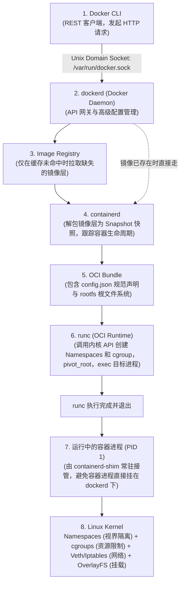

在 Linux 主机上启动一个 nginx 容器，然后在主机终端运行 `ps aux`，你会直接在主机进程列表中看到这个 nginx 进程，它拥有一个普通的宿主机 PID。**这里没有启动任何 Guest OS 内核，也没有启动 Hypervisor 虚拟机监控器。**

这个直观的现象道破了容器的本质：

> [!note] 容器的本质
> **容器只是一个普通的 Linux 进程，内核答应向它“撒谎”（通过 Namespaces 隔离它能看到的世界），并对其进行“配给”（通过 cgroups 限制它能使用的资源）。** 所谓的 `docker run`，本质上就是把这两件事组装起来的管道工程（Plumbing）。

知识库关联：关于容器管理与编排可参考 [[docker-compose]]，常用底层操作参考 [[linux-commands]]。

---

## 一次 `docker run` 的完整下沉链路

以命令 `docker run -p 8080:80 nginx` 为例，请求从用户 CLI 一路下沉到 Linux 内核经历以下阶段：



### 关键阶段解析

1. **Docker CLI 是纯 REST 客户端**：它通过 `/var/run/docker.sock` 与守护进程通信。你可以用 `curl --unix-socket /var/run/docker.sock http://localhost/info` 获得完全相同的通信效果。
2. **dockerd 不直接启动进程**：它将任务委托给 `containerd`，由后者负责镜像快照解包与容器生命周期追踪。
3. **OCI Bundle 是全量配方**：通过 `runc spec` 可以生成一份标准的 `config.json`，其中详细定义了需要创建的 5 个核心命名空间（`pid`, `network`, `mount`, `uts`, `ipc`）及资源限额。
4. **runc 干完活就跑（Ephemeral）**：runc 完成内核系统调用配置、挂载根文件系统（`pivot_root`）、降权（Drop Capabilities）并将目标程序 exec 为容器内部的 PID 1 之后，自身立即退出。后续由轻量的 `containerd-shim` 保持 I/O 监听与退出状态汇报。

---

## Namespaces：控制进程“能看到什么”

命名空间为进程构建了独立的虚拟视界。每个 Linux 进程都有自己的命名空间集合，对应 `/proc/<PID>/ns/` 下的一组软链接：

```bash
$ ls -l /proc/self/ns
cgroup -> cgroup:[4026531835]
ipc    -> ipc:[4026531839]
mnt    -> mnt:[4026531841]
net    -> net:[4026531840]
pid    -> pid:[4026531836]
uts    -> uts:[4026531838]
```

两个进程若对应链接指向相同的 inode 编号，说明它们共享该命名空间；容器进程则会获得全新的一组 inode 编号。

### 不用 Docker，用 `unshare` 手动制造容器幻觉

利用 Linux `util-linux` 提供的 `unshare` 工具，非 root 用户也能亲手体验内核的“谎言”：

```bash
# 创建新的 PID、User 和 Mount 命名空间
$ unshare --user --map-root-user --pid --fork --mount-proc ps -o pid,user,cmd
    PID USER     CMD
      1 root     ps -o pid,user,cmd
```

- **PID 幻觉**：`ps` 进程坚信自己就是系统上的 **PID 1**。
- **User 幻觉**：`--map-root-user` 将外部的普通 UID 在该命名空间内部映射为 **root**。
- **UTS 隔离（主机名）**：
  ```bash
  $ unshare --user --map-root-user --uts sh -c 'hostname demo-box; hostname'
  demo-box
  $ hostname
  my-real-host  # 外部主机名完好无损
  ```

---

## cgroups：控制进程“能使用什么”

> [!warning] 隔离不等于限制
> **Namespaces 只负责隐藏，不负责限制。** 一个被关在独立 PID Namespace 的进程，如果不加资源配额，依然可以无限创建子进程，直到耗尽整台宿主机的进程表。

### Fork 炸弹的破坏机理

Fork 炸弹经典形式：`:(){ :|:& };:`。它定义了一个名为 `:` 的函数，每次执行都会在后台再 fork 出两个自身副本并链式繁殖。呈指数级膨胀的进程会瞬间塞满操作系统的 PID 表，导致整台主机彻底失去响应，只能硬重启。

### 三种进程防护手段对比

| 防护手段                | 控制粒度         | 计数基准                                                      | 对 root 用户的有效性                   | 适用场景                                                             |
| :---------------------- | :--------------- | :------------------------------------------------------------ | :------------------------------------- | :------------------------------------------------------------------- |
| `ulimit -u`             | 用户维度（UID）  | 统计该用户在**整台物理机**上的所有进程与线程总和              | **无效**（内核默认不对 root 强制执行） | 传统多租户服务器终端防御；极易因用户在其他后台已有进程而导致单次误杀 |
| `systemd (TasksMax)`    | 单元/服务切片    | 统计当前 Unit / Scope / Slice 内部的任务数                    | **有效**                               | 宿主机系统级服务防护；可按服务精准限制                               |
| `cgroups v2 (pids.max)` | 控制组（cgroup） | 统计当前 cgroup 树节点内部的所有进程/线程数，无论归属哪个 UID | **有效**                               | **容器资源配额的核心基石**；Docker `--pids-limit` 的底层实现         |

---

## 阻止 Fork 炸弹：内核实战与生产指标

在启用了 cgroups v2 的现代 Linux 发行版上，我们可以在一个被限制为最多 10 个任务的临时作用域（Scope）中运行一段连续 fork 50 次的 Python 进程：

```bash
$ systemd-run --user --scope -p TasksMax=10 python3 -c '
import os, time
n = 0
try:
    for _ in range(50):
        if os.fork() == 0:
            time.sleep(2)
            os._exit(0)
        n += 1
except OSError as e:
    print("started", n, "children, then:", e)
'
```

### 终端输出与内核响应

```text
Running scope as unit: run-r01155c5e085f497f94c998714d8323f5.scope
started 9 children, then: [Errno 11] Resource temporarily unavailable
```

- **精确阻断**：9 个子进程加上 Python 父进程自身恰好达到 **10 个任务上限**。第 10 次 `fork()` 直接被内核拒绝并抛出 `EAGAIN`（`[Errno 11] Resource temporarily unavailable`）。
- **零外部影响**：宿主机上的其他任何服务完全不受干扰，没有产生全局进程饥饿。

### Docker 容器的等价限制

在 Docker 中使用 `--pids-limit` 标志：

```bash
docker run -d --pids-limit 100 nginx
```

在容器底层对应的 cgroup 目录中，内核会将此值写入：

```bash
# 查看容器内部生效的限制（若输出 max 则表示无限制）
$ docker run --rm alpine cat /sys/fs/cgroup/pids.max
```

> [!important] 生产排错与监控指标：`pids.events`
> 当需要为容器配置告警时，**不要只监控当前的进程数**，而应该直接采集 `/sys/fs/cgroup/.../pids.events` 文件：
>
> ```text
> max 1
> ```
>
> 其中的 `max` 计数器记录了**内核因为触碰 `pids.max` 上限而拒绝 fork 的累计次数**。如果该值大于 0 且在增长，说明容器内部存在进程泄漏或正遭遇恶意耗尽攻击。

---

## 总结：容器技术的设计全貌

1. **组合而非发明**：Docker 并没有发明新的内核隔离机制，而是将 Linux 积累多年的 Namespaces、cgroups、Capabilities、OverlayFS 和 iptables 包装成了一套标准化、易分发的工程流水线。
2. **两者的分工边界**：
   - **Namespaces** 解决“我看得到什么”（视图边界）。
   - **cgroups** 解决“我能用多少”（资源边界）。
3. **安全启示**：未指定 `--pids-limit` 或内存限额的容器，即便拥有完全隔离的命名空间，依然具备耗尽宿主机全局资源的能力。生产环境中必须为关键容器显式设定上限并监控 `pids.events`。
