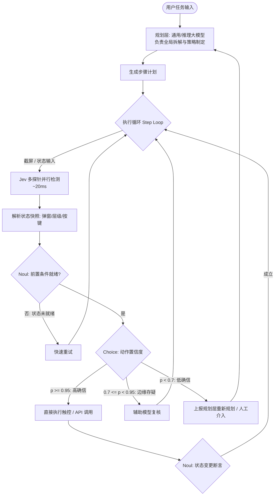

### 1. 核心定位与设计目标

**Jev** 是由 TypeSafe AI（由前 OpenAI 研究员 Diogo Almeida 等人创立）于 2026 年 9 月发布的决策模型。其定位为“系统一（System One）模型”，不具备生成自然语言长句或散文的能力，输入上下文后直接输出结构化判定结果与概率分布。

> [!note] 命名溯源：杰文斯悖论（Jevons' Paradox）
> 模型名称来自 19 世纪英国经济学家威廉·斯坦利·杰文斯（William Stanley Jevons）。**杰文斯悖论**指当某项资源利用效率提高、成本下降时，该资源的总消耗量往往会增加。
> Jev 的设计目标是通过大幅降低单次判定的延迟与成本，使软件能够像调用常规条件语句一样密集使用模型决策。

---

### 2. 决策原语与多探针并发

Jev 接收上下文状态（State），在**单次前向传播**中处理以下三种类型的问题定义：

```
                    ┌─► Choice (分类 / 路由) ──► 选项 + 概率分布
                    │
输入状态 (Context) ──┼─► Score  (评估 / 打分) ──► 数值 + 置信区间
                    │
                    └─► Noul   (真伪 / 判定) ──► 伯努利概率 (0.0 ~ 1.0)
```

1. **Choice（分类与路由）**
   - **用途**：从预设选项列表中匹配目标项（例如工单分类、工具选择、UI 目标元素选择）。
   - **输出**：目标选项、各选项概率分布与置信度。
2. **Score（分级与评分）**
   - **用途**：按连续或离散区间评估打分（例如风险等级 1~~5、内容合规分值 0~~100、图层对齐程度）。
   - **输出**：得分值、期望值与概率分布。
3. **Noul（真伪判定）**
   - **用途**：判断条件是否成立（例如“弹窗是否已关闭”、“输入是否违规”）。
   - **命名来源**：统计学中的**伯努利试验（Bernoulli Trial）**。
   - **输出**：命题为 True 的概率值（0.0 ~ 1.0），可直接作为程序布尔判断依据。

> [!tip] 单帧多探针（Multi-Probe）
> 单次 API 调用支持同时传入多个问题探针。例如传入一帧界面截图后，模型可在一次前向传播中同时返回：弹窗是否可见（Noul）、主按钮状态（Choice）、页面加载完成度（Score）。

---

### 3. 架构与训练方法

#### 非自回归结构（Non-Autoregressive Transformer）

自回归大语言模型（[[llm-overview|LLM]]）依赖逐 Token 生成，即使输出布尔值或 JSON 片段，也需要多次解码迭代，端到端延迟通常在数百毫秒至数秒。
Jev 采用非自回归架构，通过单次前向传播并行计算所有目标输出，消除解码循环，平均延迟在 10ms ~ 30ms。

#### RLCD（校准决策强化学习）

传统 [[rlhf|RLHF]] 训练倾向于让模型给出极端置信度，输出的概率往往无法直接等同于经验准确率。

TypeSafe AI 采用 **RLCD（Reinforcement Learning for Calibrated Decisions，校准决策强化学习）**：

- 以**统计校准度（Statistical Calibration）**为优化目标；
- 当模型给出 0.8 的置信概率时，统计意义上的经验准确率对应趋近 80%；
- 允许系统设置确定的放行阈值（例如 $p \ge 0.95$ 自动执行，$p < 0.8$ 转人工复核）。

---

### 4. 指标与特性对比

| 维度           | 自回归生成模型 (Chat LLM)        | Jev (System One Model)                    |
| :------------- | :------------------------------- | :---------------------------------------- |
| **输出形式**   | 自然语言文本 / JSON 字符串       | 结构化强类型数据（Choice / Score / Noul） |
| **单次延迟**   | 500ms ~ 3000ms+（逐 Token 解码） | 10ms ~ 30ms（单次前向传递）               |
| **单次成本**   | 较高（按输入/输出 Token 计费）   | 较低（约为生成模型的 1/200 ~ 1/400）      |
| **输出确定性** | 存在格式偏移、JSON 语法错误风险  | 类型安全，无需额外 JSON 解析与重试        |
| **概率可用性** | 缺乏可靠校准                     | 经 RLCD 统计校准，可直接设阈值分流        |
| **接入方式**   | 提示词工程（Prompt Engineering） | 类型化 API / SDK 传参                     |

---

### 5. 端到端 Agent（Mobile / Design App）落地实践

在设计软件（如 Figma/Canvas）与移动系统操作（Phone-use / OS-Agent）中，Jev 承担**高频微决策与执行校验**，与负责全局规划的 [[reasoning-model|Reasoning Model]] / 通用大模型配合：



#### 常见模式

##### 1. 状态变更断言（State Assertions）

GUI 自动化中经常遇到指令已发送但界面未响应的问题。可以使用 `Noul` 原语进行前后状态校验：

- 操作前校验：`assert jev.ask_noul(screen, "Confirm dialog is visible") > 0.9`
- 操作后校验：`assert jev.ask_noul(screen, "Confirm dialog is dismissed") > 0.9`
- 未通过时可在几十毫秒内触发局部重试，避免等待长超时。

##### 2. 置信度阶梯分流（Confidence-based Escalation）

依托 RLCD 的校准概率划分执行策略：

```python
# 移动端目标选择与分流示例
decision = jev.ask_choice(
    context=screen_state,
    question="Which element is the target 'Export' action button?",
    options=["btn_export_canvas", "btn_cancel", "btn_share"]
)

if decision.confidence >= 0.95:
    # 高确信：直接调用系统驱动点击
    driver.tap(decision.best_choice)
elif decision.confidence >= 0.70:
    # 存疑：调用轻量视觉规则或副探针二次确认
    double_check(screen_state, decision)
else:
    # 低确信：回退到规划模型重新推理或提示用户确认
    escalate_to_planner(screen_state, decision)
```

##### 3. 设计工具图层消歧与对齐质检

- 使用 **Choice** 原语在重叠或相近图层候选中命中目标；
- 使用 **Score** 原语（0~100）评估排版对齐或对比度，作为 Agent 生成设计内容后的自动化校验门禁（Quality Gate）。

---

### 6. 适用与不适用场景

- **不适用场景**：
  - 自然语言对话、长文本创作与文档总结；
  - 复杂代码编写、长因果链条推理（这类任务仍由 [[reasoning-model|Reasoning Model]] 处理）。
- **适用场景**：
  - 输入内容的安全与合规过滤（Guardrails）；
  - 自动化流程中的条件判断与分支跳转；
  - 移动端/桌面端的 UI 状态检测与动作目标路由；
  - 智能客服与工单分类分流。
