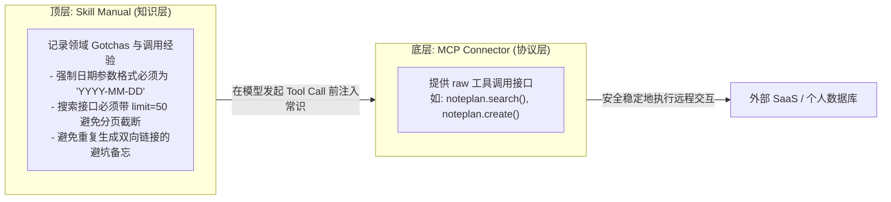

近期在 AI 开发者社区（尤其是 X 与各大开源社区）出现了一种激进的声音：“**MCP（Model Context Protocol）已死，`SKILL.md` 才是唯一未来**”。不少人主张淘汰复杂的 MCP Server，转而向代码库丢一个 Markdown 文件，命令 Agent 安装一个本地 CLI 工具来解决所有外部能力接入。

针对这种思潮，重度 AI 开发者 David（日常重度依赖 Claude Code、Codex、Gemini、ChatGPT 等）在其博文《_I Still Prefer MCP Over Skills_》中提出了极具洞察力的技术反思：**纯知识型 Skill 固然优秀，但企图用「CLI + Skill 说明书」取代「MCP 标准连接器」不仅不是进步，反而是架构上向脆弱生态的巨大倒退。**

知识库关联：关于 MCP 与工具列表在 Harness 中的全量机制请参考 [[anatomy-of-coding-agent-harness]]，通用 Agent 技能体系参考 [[agent-skills]] 与 [[agent-workflow-patterns]]。

---

## 核心论点与术语重构

> [!note] 一句话厘清分工边界
> **MCP 的本质是连接器（Connectors），解决“连上外部实体（What）”的标准化协议；Skills 的本质是操作说明书（Manuals / `LLM_MANUAL.md`），解决“如何高效使用系统与规避暗坑（How）”的知识封装。**
>
> 理想的工程架构绝非非此即彼，而是：**由 MCP 提供安全、便携、免安装的连接层，由 Skills 作为其上的操作指南与备忘单（Cheat Sheet）。**

---

## 架构对比：MCP 连接器 vs. 技能说明书

```mermaid
flowchart TD
    subgraph ClientLayer["客户端生态 (全平台)"]
        Web["Web 网页版<br/>(ChatGPT / Claude Web / Perplexity)"]
        Mobile["手机移动端<br/>(iOS / Android 客户端)"]
        Local["本地执行环境<br/>(Claude Code / Codex / Cursor / 终端)"]
    end

    subgraph MCPArch["MCP 架构 (Remote Connector)"]
        MCPClient["MCP 协议客户端<br/>(原生支持 Tool Search 按需发现)"]
        OAuth["OAuth 标准鉴权<br/>(无明文密钥暴露)"]
        MCPServer["Remote MCP Server<br/>(云端托管 / 沙盒隔离 / 集中自动升级)"]
        ServiceA["外部服务<br/>(Notion / Gmail / Fastmail / 业务 API)"]

        MCPClient --> OAuth --> MCPServer --> ServiceA
    end

    subgraph SkillCLIArch["Capability Skill + CLI 架构"]
        SkillMD["SKILL.md 说明书<br/>(告诉 Agent 如何调用本地命令行)"]
        EnvFile[".env 环境变量<br/>(明文暴露 API Token)"]
        LocalBin["专用 CLI 二进制<br/>(gogcli / remindctl / npm 包)"]
        ServiceB["外部服务"]

        SkillMD --> EnvFile --> LocalBin --> ServiceB
    end

    Web -.->|完美兼容| MCPArch
    Mobile -.->|完美兼容| MCPArch
    Local -->|完美兼容| MCPArch

    Web x-.-x|完全不支持 (无 Shell/二进制环境)| SkillCLIArch
    Mobile x-.-x|完全不支持 (无本地计算环境)| SkillCLIArch
    Local -->|勉强可用 (但带来包依赖与密钥管理混乱)| SkillCLIArch
```

### 详细特性矩阵对比

| 评估维度                           | Remote MCP（远程连接器）                                                        | Capability Skills + 本地 CLI                                                                              |
| :--------------------------------- | :------------------------------------------------------------------------------ | :-------------------------------------------------------------------------------------------------------- |
| **跨平台可移植性 (Portability)**   | **全平台通吃**。手机端、网页端、轻量环境只需填入 Server URL 即可使用。          | **环境严重受限**。仅在 Claude Code、Codex 等具备本地完整 Shell 的重量级环境可用，网页版与手机端直接死锁。 |
| **依赖安装与部署 (Deployment)**    | **零安装（Zero-Install）**。客户端无须安装任何本地运行时或二进程包。            | **部署碎片化**。用户必须手动配置 `npm`、`uv`、`brew` 或系统环境变量。                                     |
| **版本无缝迭代 (Updates)**         | **服务端热更新**。服务端增加工具或修复 Bug，全球所有客户端瞬间生效。            | **版本陈旧滞后**。用户机器上的 CLI 二进制必须手动拉取与重新升级。                                         |
| **密钥安全性 (Secret Management)** | **标准优雅**。通过 OAuth 授权流完成握手，Token 储存在隔离沙盒中。               | **明文裸奔**。通常强依赖本地 `.env` 纯文本存储；临时容器一旦重启，密钥即刻丢失。                          |
| **沙盒与安全防护 (Sandboxing)**    | **天然沙盒隔离**。仅暴露严格声明的 Tool 函数，不会赋予模型本地任意命令执行权。  | **过度提权**。模型为了运行 CLI，获得了执行任意 Shell 命令的系统高危权限。                                 |
| **上下文按需检索 (Discovery)**     | **按需加载（Tool Search）**。现代客户端具备工具搜索能力，仅在调用时拉取上下文。 | 初始依靠 Prompt/Description 匹配，若包含大量 CLI 帮助文档易膨胀。                                         |

---

## 为什么滥用“CLI + Skill”是一场倒退？

当开发者试图用 `SKILL.md` 替代一切外部服务集成时，陷入了所谓的“**万物皆 CLI**”陷阱：

1. **终端沙文主义的傲慢**：
   - 很多重度命令行开发者默认所有用户都在全功能的 macOS/Linux 终端里跑 Agent。然而，数以千万计的用户使用的是 iPad、手机 App 或纯 Web 端交互。
   - 要求“查一下日历”就必须在本地安装一个 `calendar-cli` 并配置本地密钥，彻底切断了非终端环境接入智能的可能。
2. **密钥管理的梦魇**：
   - 本地 CLI 无法原生承载复杂的三方授权流。为了让 Agent 能够调通接口，用户被迫去开发者后台申请 Long-lived API Token，并将这些高危机密以明文形式贴在各种临时目录的 `.env` 中。
3. **生态割裂与管理蛮荒**：
   - 目前除了少数通过 `npx skills` 分发的规范包外，大多数 Skill 的安装全靠在各个目录乱拷 Markdown；一旦底层接口变更，分布在各处的说明书迅速沦为过时伪代码。

---

## 那么，Skills 真正的统治区在哪里？

作者明确指出，他反对的是“**能力型（Capability）Skill 取代连接器**”，而非否定 Skills 本身。Skills 在以下**纯知识、流程约束与心智模型传递**场景具有无可替代的统治力：

- **编码哲学与领域规范**：指导 Agent 如何撰写符合团队审美的 Commit Message、如何编写特定架构的单元测试、如何规避代码中的过度工程化。
- **文件与介质处理指南**：例如 Anthropic 官方的 `read_pdf` Skill，它教给模型的是“如何利用现有 Python 脚本对 PDF 进行解包、解析 XML 结构与提取素材”，而非凭空造一个外接服务。
- **项目级私有工具约束**：例如在仓库中约定“本代码库统一使用 `fnox` 管理密钥，执行命令前请按以下姿态读取配置”，这比写一个无谓的 MCP 去调 `get_secret()` 优雅百倍。

---

## 终极方案：Skills + MCP 混合协同架构

最成熟、最优雅的工业级方案是：**不要用 Skills 去消灭 MCP，而是在 MCP 连接器之上，封装一层轻量的“避坑与用法说明书”**。



### 生产实战工作流：让 Agent 自动为 MCP 沉淀 Skill

David 在日常开发 NotePlan 等 MCP 集成时的经典闭环：

1. **探索与踩坑**：在对话中通过 MCP 操作外部服务，难免会遇到 API 参数命名不直观、日期格式要求为 `YYYY-MM-DD`、特定参数不加会导致截断等隐蔽暗坑。
2. **就地沉淀为 Skill**：当解决完这批坑点后，直接让 Agent：“_将我们刚才调试该 MCP 所发现的所有非显而易见的注意事项、参数格式与最佳实践，打包写成一个专门针对此 MCP 的 Skill。_”
3. **后续会话自动获益**：未来的任何一个 Agent 会话在唤醒该 MCP 时，首先读取这篇“操作备忘单”，**绝不在同一个坑里浪费 Token 重复试错**。

---

## 总结：专业分工才是正道

- **MCP 是桥梁（Connectors）**：为整个 AI 生态提供跨设备、免安装、安全受控的标准化数据通道；
- **Skills 是地图（Manuals）**：教导模型如何看懂地图、如何以最优雅的姿态驾驶工具；
- **行业呼吁**：不要放弃 MCP 的标准化进程去倒退回各种简陋脆弱的临时 CLI 拼凑体，标准化连接层（MCP）与敏捷知识层（Skills）的结合，才是自主智能体走向健壮工程的正确方向。
