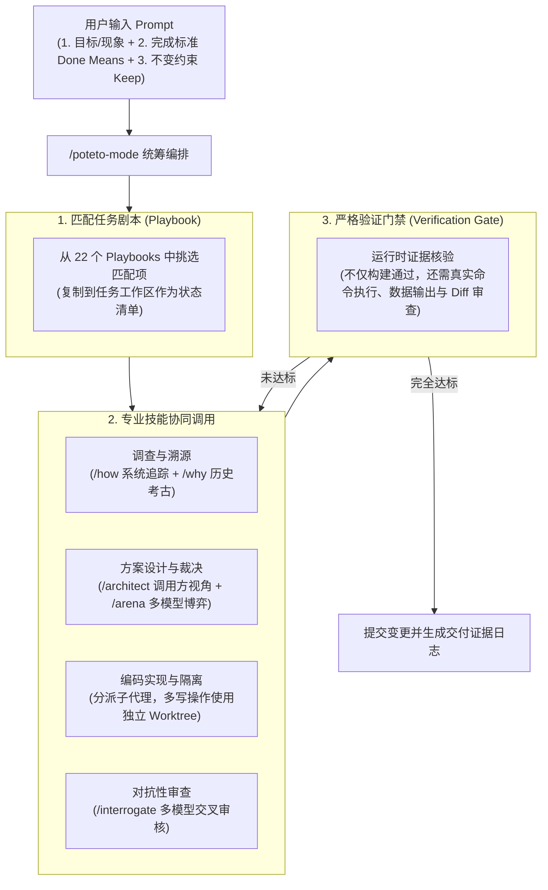

AI 编程智能体能够以极高的速度写出大量代码，但真正的软件工程并不仅仅是“产出代码”：它包含**理解既有系统、选择稳健的设计方案、运行时严格验证、审查 Diff 变更、以及在不破坏任何关联功能的前提下完成交付**。

**`pstack`** 是由 Lauren Tan（[@poteto](https://x.com/poteto)，曾任职于 Cursor 团队）主导构建的严谨 Agent 工作流体系。它的核心诉求不是让 Agent 写“更多代码”，而是**写更少但更高质量的代码，并建立端到端的验证机制**，使得多个 Agent 可以在同一个代码库中并行协作，而不至于将项目变成难以维护的“代码垃圾场”。

知识库关联：关于 Coding Agent 的底层 Harness 编排可参考 [[anatomy-of-coding-agent-harness]]，计划与状态机模式参考 [[claude-code-plan-mode]]，通用技能生态参考 [[agent-skills]]。

---

## 核心设计理念：把 Agent 当成工程团队管理

在企业管理中，新入职的工程师需要熟悉代码库、理解团队的排错方式、遵循设计模式、编写完备测试并与团队对齐。AI Agent 也需要同样的规范——差别在于 **Agent 的上下文会不断被压缩或重置，它总是在“遗忘”**。

`pstack` 将人类工程团队的高效研发习惯，固化为可被模型严格执行的代码与规范文件：

- **24 个 Workflow Skills（工作流技能）**：如调查追踪、架构设计、多模型竞技、对抗性代码审查。
- **22 个 Task Playbooks（任务剧本）**：将常见研发场景沉淀为 SOP 标准作业程序。
- **23 项 Engineering Principles（工程原则）**：约束模型不可妥协的工程纪律。
- **跨平台兼容**：核心是一组基于 Markdown 的 `SKILL.md`，不仅能运行在 Cursor 中，也能通过规范导入 [[claude-code]] 和 Codex。

---

## 全景架构与 `poteto-mode` 状态流转

在日常开发中，开发者无需记忆所有 40 多个单独命令，而是通过统一入口 **`/poteto-mode`** 启动自动化闭环：



### `/poteto-mode` 标准输入三要素模板

使用 `pstack` 推进任务时，最有效的提示词结构如下：

```text
/poteto-mode [你观察到的具体问题现象，或者你期望实现的功能目标]
Done means [模型可自主执行、能明确输出判断结果的验收命令或断言方式]
Keep [绝对不能被破坏的既有行为、向后兼容性或业务规则]
```

例如：

```text
/poteto-mode 为订单查询命令增加 --json 输出选项。
Done means 运行该命令时不带参数输出可读文本表格，带 --json 参数输出合法 JSON 并能通过 jq 校验。
Keep 保持现有的退出码约定与标准错误（stderr）排错信息不变。
```

---

## 核心工作流技能（Skills）矩阵

`pstack` 将复杂的长链路工作拆分为职责分明的离散技能：

| 技能命令           | 核心职责                 | 典型使用场景与工作机制                                                                                           |
| :----------------- | :----------------------- | :--------------------------------------------------------------------------------------------------------------- |
| **`/how`**         | **当前系统运行链路追踪** | 传入子系统名称或功能，从入口函数一路向下追踪调用图（Call Graph），解释系统当下“如何运作”。                       |
| **`/why`**         | **历史决策因果考古**     | 结合 Git 提交日志、PR 讨论与架构记录，追溯代码为什么写成今天这样，防止误删“前人故意留下的防坑机制”。             |
| **`/teach`**       | **机制与历史融会贯通**   | 结合 `/how`（当前机制）与 `/why`（历史演进），向开发者系统讲解复杂模块的设计脉络。                               |
| **`/architect`**   | **调用方视角驱动设计**   | **从消费者的调用姿态出发（Caller-first）**：先写出优雅的调用方代码示例，再反向推导接口签名与内部实现。           |
| **`/arena`**       | **多模型架构竞技场**     | 对同一个棘手的技术难题，唤醒多个不同的大模型并行给出独立架构方案，相互质疑并评估优劣，挑选最佳方案。             |
| **`/swarm`**       | **多任务分治并行**       | 与 `/arena`（多方案解一题）不同，`/swarm` 是将一个大工程拆分为多个互不依赖的子模块，分派给不同 Worker 并行编写。 |
| **`/interrogate`** | **多模型对抗性代码审查** | 召唤不同模型扮演挑剔的 Staff 工程师，逐行审查 Git Diff，重点排查竞态条件、边界失效与过度设计。                   |
| **`/verify`**      | **运行时证据收集**       | 严禁只看编译通过。强制执行端到端命令、抓取 API 响应或捕获 UI 截图，将实打实的运行日志作为验收凭证。              |
| **`/recall`**      | **现场上下文重建**       | 当会话中断或跨天恢复时，从仓库中的日志和任务文件中快速唤醒上下文，继续推进任务。                                 |
| **`/bro`**         | **大白话极简重写**       | 当 Agent 输出的最终总结过于冗长晦涩、充满行话时，将其一键重写为自然易懂的简练口语。                              |

---

## 23 项工程原则（Engineering Principles）精要

`pstack` 将 23 条软件工程红线固化为模型的系统约束，其中最核心的几条包括：

1. **先复现，再动笔（Reproduce before fixing）**：在动手修改 Bug 之前，必须先写出一个能稳定复现失败的测试用例或最小脚本。
2. **绿色构建不等于功能正确（A green build is not proof）**：代码通过编译和旧单测，仅仅代表没有破坏既有语法；必须专门设计针对新改动的验证逻辑。
3. **调用方优先（Start from caller usage）**：设计 API 时，永远先写出“调用方最舒服的代码样子”，严禁从底层内部实现反向绑架接口设计。
4. **少写代码是美德（Less code is better）**：鼓励复用既有模块，严禁为了显示能力而引入冗余的抽象层和用不上的设计模式。
5. **多写者必须隔离（Isolate parallel writers）**：多个子代理同时工作时，必须分配独立的 Git Worktree 或不同的文件输出目录，防止写冲突。
6. **怀疑一切审查结论（Verify review findings）**：审查代理提出的建议必须结合上下文甄别，不要盲目合并会导致架构倒退的修改。

---

## 落地实践与选型权衡

### 1. 什么时候该用 `pstack`？

- **适合**：
  - 复杂的大型技术改造、多步版本迁移；
  - 棘手的并发竞争、内存泄漏或疑难 Bug 排查；
  - **跨夜长任务（Overnight Runs）**：人类设定好目标、断言与约束后，由 Agent 自主推进并在次日清晨交出完整的决策与运行证据链。
- **不适合**：
  - 修复简单的拼写错误、改动单行文案或微调单点配置；
  - 琐碎任务如果启动全套 `pstack` 流程（多模型博弈 + 对抗审查 + 现场记录），会引入过多的“流程仪式感（Ceremony）”并消耗不必要的 Token。

### 2. 模型路由与分层配置（Role-Based Routing）

在 `pstack` 中，并非所有角色都必须使用最昂贵的旗舰模型：

- **日常调查与任务推进（Planner / Worker）**：可使用轻量高性比模型（如 Claude Sonnet / Composer）；
- **架构竞技与对抗审查（Architect / Reviewer）**：指定顶尖旗舰模型（如 Claude Opus / GPT-5 级别）把关关键设计与安全底线。

---

## 总结：从“随机生成”走向“确定性交付”

`pstack` 的成功表明，**AI 编程的瓶颈早已从模型的基础代码生成速度，转移到了软件工程流程的管控精度**。通过清晰的状态机（`poteto-mode`）、标准作业程序（Playbooks）、专用原子能力（Skills）与不可动摇的工程铁律（Principles），开发者得以将强大的模型锁入安全、可审计、高确定性的工程轨道中。
