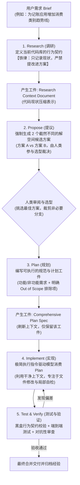

当 Andrej Karpathy 提出“Vibe Coding（氛围编程：指凭感觉下提示词，双手离开方向盘交由 AI 驱动）”时，它迅速席卷了个人开发者的日常探索。然而在企业级复杂软件系统中——面对跨越成百上千个文件、数百万行代码的庞大仓库时——纯粹的 Vibe Coding 往往会导致代码混乱、破坏隐藏契约与难以收敛的幻觉。

在斯坦福大学课程 **The Modern Software Developer**（2026-09-29 课堂实录）中，**Mihail Eric** 系统拆解了工业界在应对高难度研发任务时的标杆方法论：**REPIT 框架（Research → Propose → Plan → Implement → Test）**。

> [!note] 核心工程哲学
> 编码智能体最擅长的是**信息压缩与代码生成**，但最脆弱的是**面对庞大上下文时的注意力涣散与目标漂移**。REPIT 框架将一次软件迭代强制拆分为 5 个离散的阶段门禁：**前期（调研/提议/规划）重兵投入顶级推理模型与人类审核，后序（实现/测试）利用极简干净的上下文和轻量模型快速执行**，用工程流程锁死 Agent 的确定性。

知识库关联：关于 Coding Agent 底层框架设计可参考 [[anatomy-of-coding-agent-harness]]，计划模式实践参考 [[claude-code-plan-mode]]，Cursor/Claude Code 规范参考 [[pstack-agent-engineering-workflow]]，上下文税与窗口控制参考 [[context-tax-and-compaction-timing]]。

---

## REPIT 五步闭环全景架构

---

## REPIT 核心阶段深度规范

### 1. Research（代码库调研与契约提炼）

- **核心定位**：将庞大的代码库蒸馏为一份紧凑、高密度的上下文表征，作为后续步骤的养料。
- **不可逾越的 Prompt 铁律**：**只记录现状，严禁提出任何改进建议或实现方案**。
  - _为什么？_ 一旦允许 Agent 在调研阶段自由发挥，它会立即发散出各种未经验证的重构想法，不仅严重污染后续步骤的上下文，还会让调研结果偏离客观事实。
- **产出工件**：一份结构化的调研文档，明确列出当前涉及的组件、现有接口的数据结构、以及系统当下恪守的**行为契约（Behavioral Contracts）**。

### 2. Propose（解空间多方案博弈）

- **核心机制**：拿着调研文档与功能诉求，要求 Agent 给出 **2 个不同维度的技术候选方案**。
- **最佳方案数量（为什么是 2 个？）**：
  - 1 个方案缺乏对比，容易陷入模型的首选偏见；
  - 3 个或 4 个方案在实战中表现出明显的边际收益递减（Diminishing Returns），不仅消耗过多人类审阅时间，且方案之间往往大同小异；
  - **强制要求 2 个方案**：例如一个倾向于“最小化改动与简单性”，另一个倾向于“高可扩展性与统一架构”，足以覆盖关键权衡点。

### 3. Plan（编写端到端实施方案）

- **核心定位**：在人类裁定选型后，生成一份无需外部上下文即可独立执行的详细设计工件。
- **必须包含的关键章节**：
  1. **Current State**：代码库当前状态（直接引用 Phase 1 的提炼结果）。
  2. **Requirements**：功能需求与非功能需求（性能、安全、回滚方案）。
  3. **Out of Scope（明确不做的事情）**：**这是整份计划中最具防御价值的章节**。明确列出“本次迭代坚决不做的事项”，强行掐断 Agent 自作主张扩展需求、引入无用抽象的冲动。

### 4. Implement（极简指令驱动实现）

- **提示词设计哲学**：在经过了前三步的充分推导后，实现阶段的 Prompt 应该**极其简短直接**（例如：`"请按计划文件 plan.md 逐步实施代码改动"`）。
- **上下文纯净度**：模型在实现时只需要专注读取计划文件并修改代码，无需挂载前面几万 Token 的讨论杂音。

### 5. Test & Verify（契约验证与审查）

- **黑盒行为验收**：由于现代 Coding Agent 的代码生成能力越来越强，底层的具体写法重要性逐渐让位于**输入与输出的行为契约（Input/Output Behavior）**。
- **自主验证（Self-Testing）**：要求模型在改完代码后，必须通过调用工具亲手运行测试命令或模拟数据，捕获真实终端日志作为通过凭据。

---

## 关键工程洞察与落地方案

### 1. 模型分层路由策略（Model Tiering）

并非所有阶段都需要消耗最昂贵的顶级模型。结合各阶段的任务特征进行分流是控制成本的核心：

| 阶段                  | 智力密度特征                         | 推荐模型档次                               | 原因与依据                                                     |
| :-------------------- | :----------------------------------- | :----------------------------------------- | :------------------------------------------------------------- |
| **Research（调研）**  | **高**（长文档理解、代码拓扑梳理）   | **顶级模型**（Frontier / High Reasoning）  | 调研是整个任务的地基，信息压缩一旦失真，后续全部跑偏。         |
| **Propose（提议）**   | **极高**（架构权衡、多维度博弈）     | **顶级模型**（Frontier / High Reasoning）  | 需要强大的理论深度与发散能力，探索合理的解空间边界。           |
| **Plan（规划）**      | **极高**（精细推演、接口契约设计）   | **顶级模型**（Frontier / High Reasoning）  | 将方案落地为精确规范，是人类杠杆率最高、最值得花费算力的环节。 |
| **Implement（实现）** | **中**（消费已定规约、局部代码编写） | **轻量/快速模型**（Mid-tier / Flash 级别） | 方案和文件路径已在 Plan 中锁死，无需过多自主架构推理。         |
| **Test（测试执行）**  | **中/低**（运行测试套件、解读报错）  | **轻量/快速模型**                          | 偏向于工具调用与结果比对，轻量模型兼具速度与低成本优势。       |

### 2. 何时刷新上下文（Context Refresh）？

在执行 REPIT 流程时，**严禁在一个无限累加的 Session 中从头跑到尾**：

- **从 Propose 进入 Implement 时必须清洗上下文**：在提议阶段讨论过的备选方案（被否决的方案 B），在进入实现阶段前**必须从上下文中彻底清除**。实测表明，上下文里残留的未采用方案，会严重混淆模型对当前实现边界的认知，诱发幻觉。
- **工件驱动衔接**：前一个阶段产出 `.md` 文本工件，新阶段直接以该工件为输入冷启动一个干净的 Context Window。

### 3. Smart Tokens（有效 Token）与上下文错觉

虽然各大模型厂商竞相宣传支持 100 万甚至 200 万超大上下文窗口，但真实研发遥测表明：

- **有效 Token 仅占 1/3 ~ 1/2**：窗口中只有 30% 到 50% 的 Token 属于推动决策的“聪明/有效 Token（Smart Tokens）”，其余充斥着冗余的依赖定义、无效日志与废话。
- **避免用大窗口代替提炼**：不要企图把整个仓储几万行代码硬塞给 Agent，第一阶段的 Research 强制信息提炼是确保模型注意力聚焦的不可替代的一环。

### 4. 任务复杂度分流准则

- **轻量任务（轻踩油门）**：修复一处文案、修补单行明显的逻辑错误、微调简单配置——直接在单个对话中单轮指令驱动，严禁启动繁重的 REPIT 流程，避免过度仪式感。
- **重型任务（启动 REPIT）**：涉及新功能引入、跨多模块改动、架构重构或陌生代码库扩展——严格走完五步闭环，由人类把守 Plan 与 Propose 的裁决门禁。
